# Variantes de robe : base, Alpha, légendaire

Une espèce existe en trois apparences. Le filtre est appliqué au corps de l'espèce
(`variantFilter` dans [`client/src/sprites.ts`](../client/src/sprites.ts)), après quoi
l'aura Alpha (violette) ou légendaire (dorée, avec couronne) se dessine par-dessus.

| Variante | Condition | Rendu |
| --- | --- | --- |
| Base | `alpha = false` | Couleur de l'espèce, aucun filtre |
| Alpha | `alpha = true` | Filtre « Alpha » de l'espèce, yeux violets |
| Légendaire (double éveil) | `legend = true` | Filtre « légendaire » de l'espèce, aura et couronne dorées |

Pas de filtre pour : les boss, les sprites à clé forcée (`u.key`) et le flash de dégât.

## Filtres par espèce

| Espèce | Alpha | Légendaire |
| --- | --- | --- |
| slime | `hue-rotate(80deg) brightness(1.1)` | `hue-rotate(-70deg) saturate(1.4) brightness(1.1)` |
| wolf | `grayscale(1) brightness(1.9) contrast(0.9)` (blanc) | `saturate(2.2) hue-rotate(-15deg) brightness(0.5) contrast(1.25)` (noir bleuté) |
| boar | `saturate(0.4) brightness(1.6)` | `brightness(0.5) saturate(1.3)` |
| golem | `hue-rotate(100deg) brightness(1.2)` | `hue-rotate(-80deg) saturate(1.6) brightness(1.05)` |
| sporelin | `hue-rotate(200deg)` | `hue-rotate(40deg) brightness(1.15) saturate(1.2)` |
| spider | `hue-rotate(110deg) brightness(1.2)` | `hue-rotate(-90deg) saturate(1.6) brightness(0.85)` |
| bear | `saturate(0.2) brightness(1.9)` | `hue-rotate(-20deg) brightness(0.6) saturate(1.5)` |
| wisp | `hue-rotate(110deg)` | `hue-rotate(-150deg) saturate(1.3) brightness(1.1)` |
| _autres (défaut)_ | `hue-rotate(35deg) saturate(1.25) brightness(1.1)` | `hue-rotate(-40deg) saturate(1.5) brightness(0.8) contrast(1.15)` |

## Aperçu

Toutes les espèces (base, Alpha, légendaire) : [variantes-alpha/all.png](variantes-alpha/all.png).

### slime

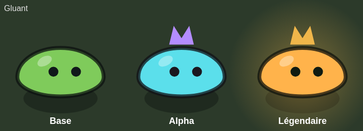

### wolf

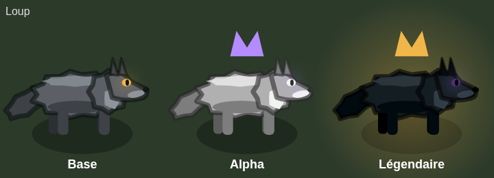

### boar

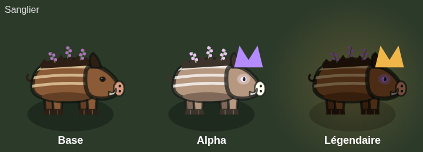

### golem

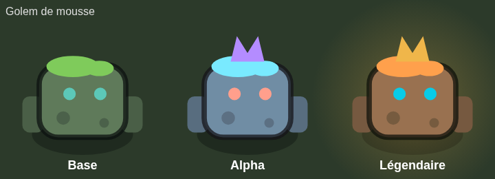

### sporelin

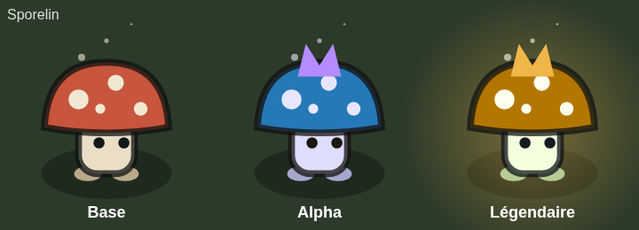

### spider

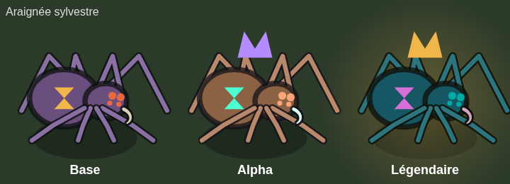

### bear

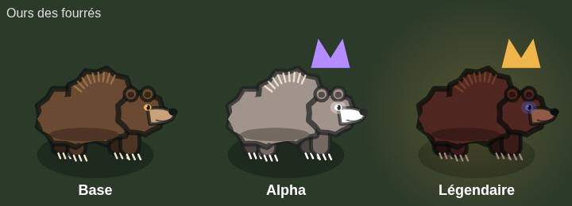

### wisp

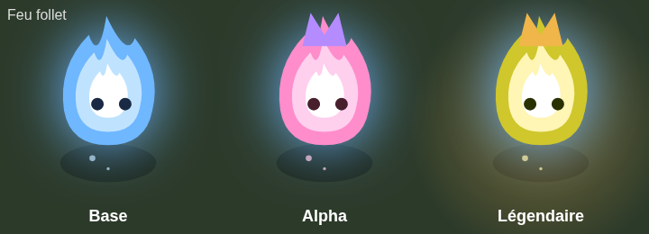

### watcher

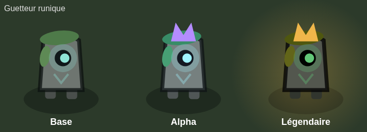

### toad

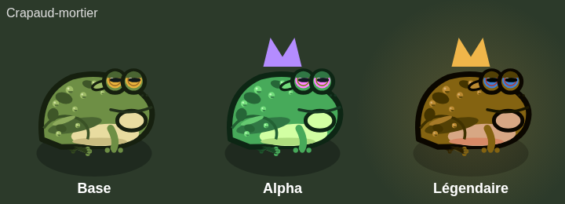

### serpent

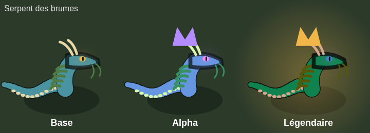

### crab

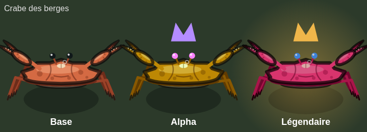

### hare

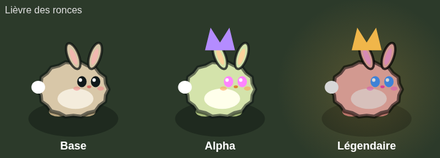

### snail

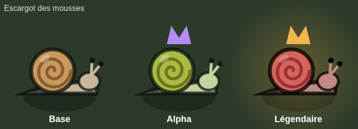

### firefly

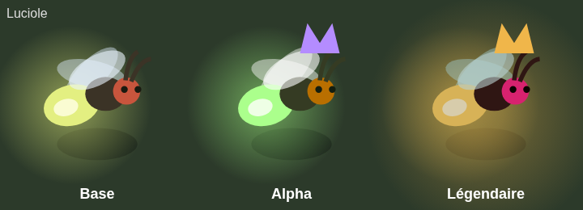

### meerkat

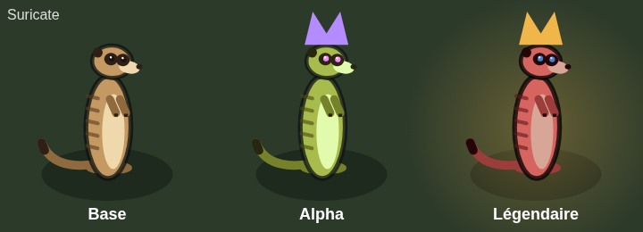

### sandworm

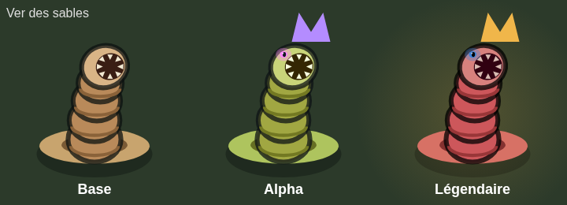

### vulture

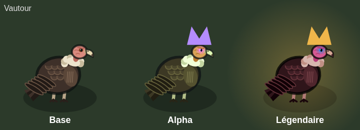

### jackal

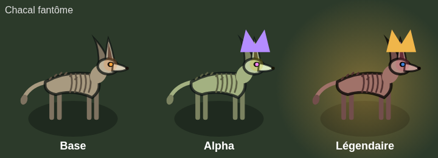

### treant

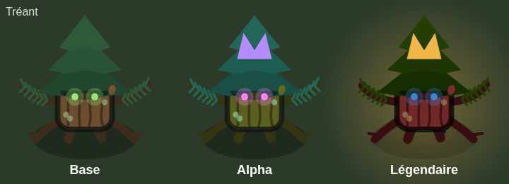

### salamander

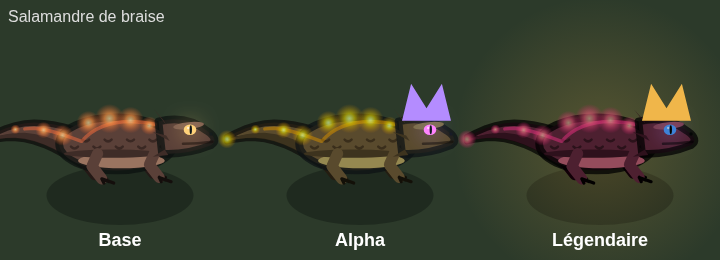

### ash_bat

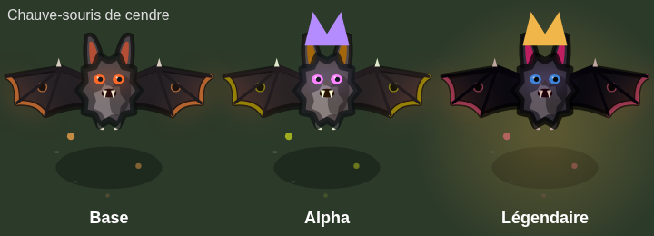

### lava_tortoise

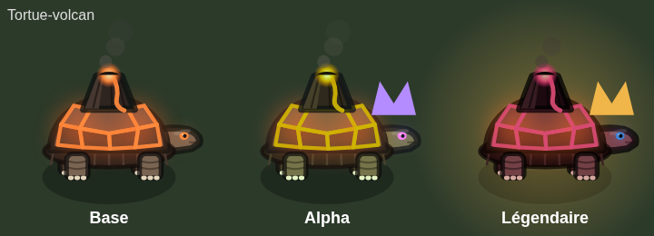

### gorilla

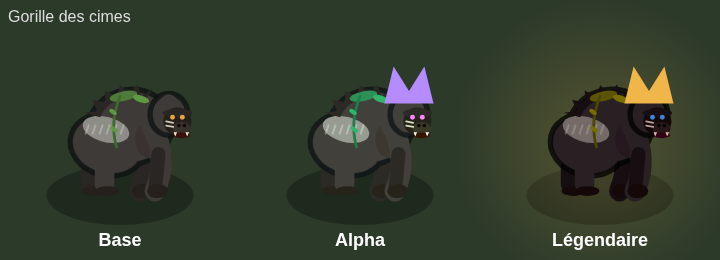

### croc

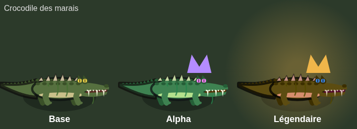

### masked

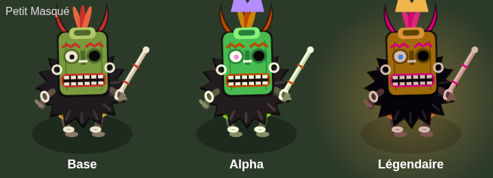

### scorpion

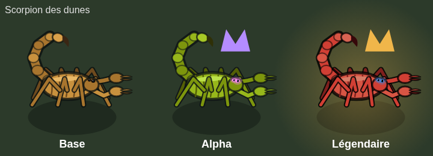

### drake

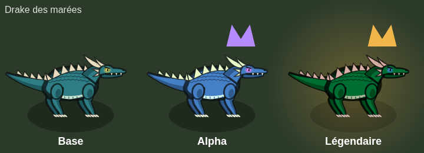

### wyvern

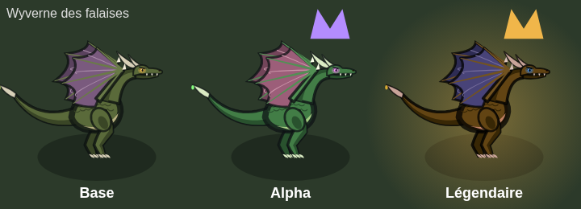

### dragon

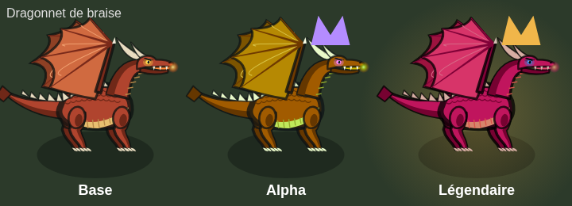

### bigfoot

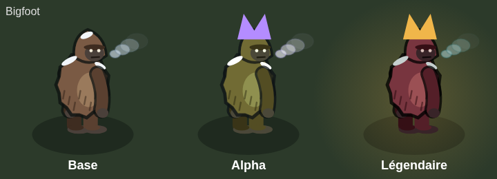

## Ajouter une espèce

Ajouter une entrée `[alpha, légendaire]` à `VARIANT_FILTERS`. Sans entrée, `DEFAULT_VARIANT` s'applique.
