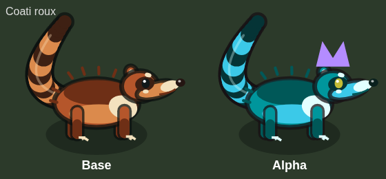

# Variantes de robe : base, Alpha, légendaire

Une espèce existe en deux ou trois apparences :

| Variante | Condition | Rendu |
| --- | --- | --- |
| Base | `alpha = false` | Couleur de l'espèce, aucun filtre |
| Alpha | `alpha = true` | **Robe de l'espèce** (filtre de couleur sur le corps, yeux compris : le violet des yeux prend la teinte de la robe), couronne violette |
| Légendaire (double éveil) | `legend = true` | **La même robe que l'Alpha**, plus des **effets visuels propres à l'espèce** (parties ajoutées, lueurs, particules), couronne et halo dorés |

La forme légendaire n'existe que pour les espèces qui ont un géant (`bossOf(s) >= 0`). Le tréant, le lièvre, l'escargot, la luciole, le suricate, le coati roux et le bigfoot n'ont donc que base et Alpha.

## Où est-ce dans le code

Tout est dans [`client/src/sprites.ts`](../client/src/sprites.ts), en fin de fichier :

- `VARIANT_FILTERS` : le filtre de couleur de chaque espèce (Alpha et légendaire). `variantFilter` le renvoie (une espèce sans entrée n'a pas de robe : `tests/rules/sprites.test.ts` vérifie que chaque espèce en a une). Le corps est dessiné dans un calque, recopié une seule fois avec le filtre.
- `LEGEND_BACK` / `LEGEND_FRONT` : les effets du légendaire, dessinés derrière / devant le corps, **sans** le filtre de couleur (ils gardent leurs vraies couleurs). Ils partagent le repère du corps ; `drawUnit` les appelle quand `u.legend` est vrai (sauf au flash de dégât).
- Pas de filtre pour les boss, les sprites à clé forcée (`u.key`) et le flash de dégât.

## Espèces avec légendaire

| Espèce | Robe (Alpha et légendaire) | Effets du légendaire |
| --- | --- | --- |
| Gluant (`slime`) | ambre doré : `hue-rotate(-75deg) saturate(1.5) brightness(1.1)` | noyau d'or qui bat, gouttes d'or en orbite, pièces collées, trois pointes de gelée dorée |
| Loup (`wolf`) | noir bleuté : `saturate(2.2) hue-rotate(-15deg) brightness(0.5) contrast(1.25)` | cristaux de glace sur l'échine, runes lumineuses sur le flanc, œil de glace, flammes de givre au bout de la queue, crinière de givre |
| Sanglier (`boar`) | bleu de tempête : `hue-rotate(195deg) saturate(1.7) brightness(0.5) contrast(1.2)` | éclairs le long de l'échine, rayures lumineuses, défense électrique, étincelles aux sabots |
| Golem de mousse (`golem`) | obsidienne sombre : `hue-rotate(-105deg) saturate(1.8) brightness(0.42) contrast(1.15)` | pointes d'obsidienne, fissures de lave qui pulsent, yeux de braise, lave qui goutte des poings |
| Sporelin (`sporelin`) | violet : `hue-rotate(275deg) saturate(1.5) brightness(0.85)` | taches et lamelles lumineuses, petits champignons sur le chapeau, spores en orbite |
| Araignée sylvestre (`spider`) | cramoisi : `hue-rotate(80deg) saturate(1.5) brightness(0.65)` | pointes dorsales, sablier qui brûle, quatre yeux de plus, venin qui goutte des crochets |
| Ours des fourrés (`bear`) | vert profond : `hue-rotate(110deg) saturate(1.5) brightness(0.75)` | cristaux d'ambre sur l'échine, rune sur l'épaule, œil et griffes qui brûlent, lucioles d'ambre |
| Feu follet (`wisp`) | magenta : `hue-rotate(105deg) saturate(1.5) brightness(0.95)` | grandes ailes de flammes, trois flammèches en orbite, anneau de runes de braise |
| Guetteur runique (`watcher`) | bronze doré : `sepia(1) saturate(2.6) hue-rotate(-8deg) brightness(0.8)` | anneau de runes d'or qui tourne, pierres runiques en orbite, anneau doré autour de l'œil |
| Crapaud-mortier (`toad`) | vert-bleu des abysses : `hue-rotate(85deg) saturate(1.5) brightness(0.6)` | crête lumineuse sur le dos, verrues qui luisent, bulles toxiques, venin qui goutte |
| Serpent des brumes (`serpent`) | violet orage : `hue-rotate(85deg) saturate(1.7) brightness(0.62) contrast(1.15)` | nageoire dorsale d'or, grandes cornes d'or, éclairs autour du cou, œil de glace |
| Crabe des berges (`crab`) | bleu des abysses : `hue-rotate(205deg) saturate(1.4) brightness(0.68)` | massifs de corail sur les épaules, perles de nacre sur le bord, yeux cerclés de lumière, billes d'eau aux pinces, anneaux de marée |
| Ver des sables (`sandworm`) | rouge basalte : `hue-rotate(-28deg) saturate(2.2) brightness(0.5) contrast(1.2)` | plaques d'os sur le dos, lignes de lave entre les anneaux, cristaux d'ambre, braises |
| Vautour (`vulture`) | blanc os : `sepia(0.45) saturate(0.8) brightness(1.75) contrast(0.95)` | disque solaire doré qui tourne, flammes d'or au bout des plumes, collier d'or et rubis |
| Chacal fantôme (`jackal`) | noir d'Anubis : `grayscale(1) brightness(0.3) contrast(1.5)` | bracelets et collier d'or, ankh sur le flanc, kohl doré, flamme turquoise au bout de la queue |
| Salamandre de braise (`salamander`) | flamme bleue : `hue-rotate(190deg) saturate(1.5) brightness(0.95)` | crête de flammes bleues, flamme au bout de la queue, cornes de basalte, fissures de feu de givre |
| Chauve-souris de cendre (`ash_bat`) | vert spectral : `hue-rotate(125deg) saturate(1.4) brightness(1.05)` | anneau de runes qui tourne, flammes vertes au bout des ailes, sceau sur le torse, cornes d'os, âmes qui dérivent |
| Tortue-volcan (`lava_tortoise`) | plasma bleu : `hue-rotate(185deg) saturate(1.3) brightness(1.0)` | pointes d'obsidienne à arête cyan, flammes bleues du cratère, halo de chaleur, gouttes de plasma |
| Gorille des cimes (`gorilla`) | blanc argent : `grayscale(1) brightness(2.5) contrast(0.8)` | grands cristaux de glace dans le dos, rune sur la poitrine, yeux de glace, givre qui tombe |
| Crocodile des marais (`croc`) | vert-noir des marais : `hue-rotate(40deg) saturate(1.3) brightness(0.6)` | plaques d'os dorées sur le dos et la queue, nénuphars et lotus lumineux, yeux d'ambre, lucioles |
| Petit Masqué (`masked`) | violet et turquoise : `hue-rotate(165deg) saturate(1.15) brightness(0.9)` | bois d'os spectraux, flammes d'esprit en orbite, braise dans l'orbite noire |
| Scorpion des dunes (`scorpion`) | noir obsidienne : `saturate(0.45) brightness(0.42) contrast(1.4)` | cristaux d'émeraude, perles de venin le long de la queue, dard vert vif, brume de venin |
| Drake des marées (`drake`) | violet sombre : `hue-rotate(95deg) saturate(1.3) brightness(0.7)` | nageoires lumineuses aigue-marine sur la crête, grande nageoire de queue, cornes d'or, perles d'or |
| Wyverne des falaises (`wyvern`) | doré, ailes bleues : `hue-rotate(-35deg) saturate(1.3) brightness(1.0)` | crête de cristaux d'orage, éclairs sur l'aile, orbe d'éclairs au bout de la queue |
| Dragonnet de braise (`dragon`) | violet du vide : `hue-rotate(255deg) saturate(1.1) brightness(0.62)` | flammes violettes sur l'échine, la queue et les ailes, cendre qui monte |

## Espèces sans légendaire (Alpha seulement)

| Espèce | Robe de l'Alpha |
| --- | --- |
| Lièvre des ronces (`hare`) | `hue-rotate(220deg) saturate(1.5) brightness(1.05)` |
| Escargot des mousses (`snail`) | `hue-rotate(100deg) saturate(1.3) brightness(1.15)` |
| Luciole (`firefly`) | `hue-rotate(120deg)` |
| Suricate (`meerkat`) | `hue-rotate(80deg) saturate(1.3) brightness(1.15)` |
| Tréant (`treant`) | `hue-rotate(170deg) saturate(1.2) brightness(1.2)` |
| Bigfoot (`bigfoot`) | `hue-rotate(160deg) saturate(0.3) brightness(1.6)` |
| Coati roux (`rufous_coati`) | `hue-rotate(160deg) saturate(1.1) brightness(1.15)` |

## Aperçu

Toutes les espèces : [variantes-alpha/all.png](variantes-alpha/all.png).

### Gluant

### Loup

### Sanglier

### Golem de mousse

### Sporelin

### Araignée sylvestre

### Ours des fourrés

### Feu follet

### Guetteur runique

### Crapaud-mortier

### Serpent des brumes

### Crabe des berges

### Ver des sables

### Vautour

### Chacal fantôme

### Salamandre de braise

### Chauve-souris de cendre

### Tortue-volcan

### Gorille des cimes

### Crocodile des marais

### Petit Masqué

### Scorpion des dunes

### Drake des marées

### Wyverne des falaises

### Dragonnet de braise

### Lièvre des ronces

### Escargot des mousses

### Luciole

### Suricate

### Tréant

### Bigfoot

### Coati roux

## Ajouter une espèce

1. Ajouter une entrée `VARIANT_FILTERS` (clé du sprite → filtre CSS).
2. Si elle a un géant : ajouter ses effets dans `LEGEND_FRONT` (et `LEGEND_BACK` pour ce qui passe derrière le corps).
